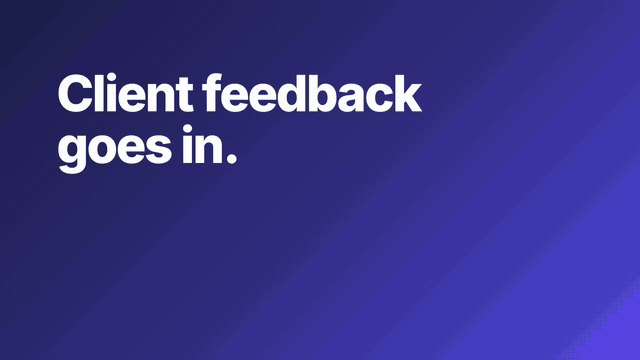
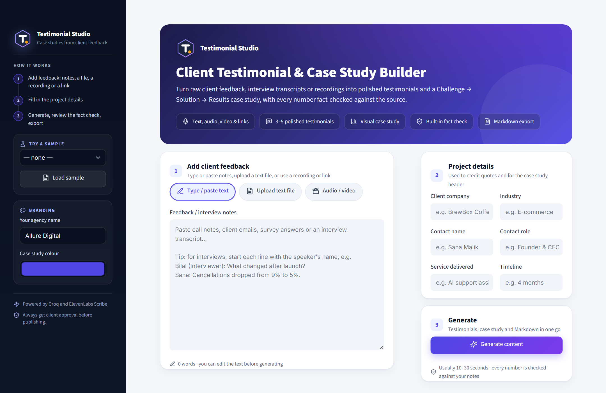
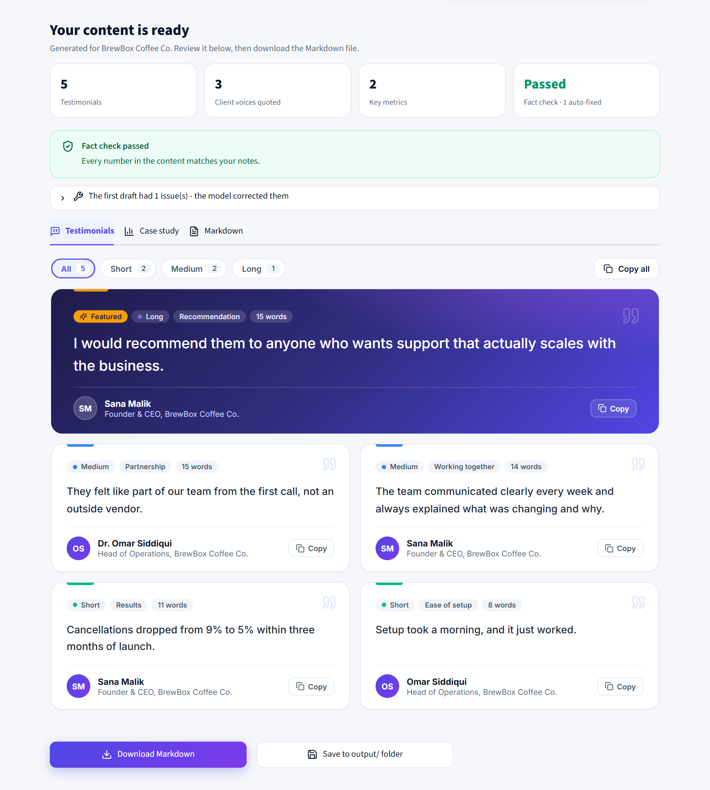
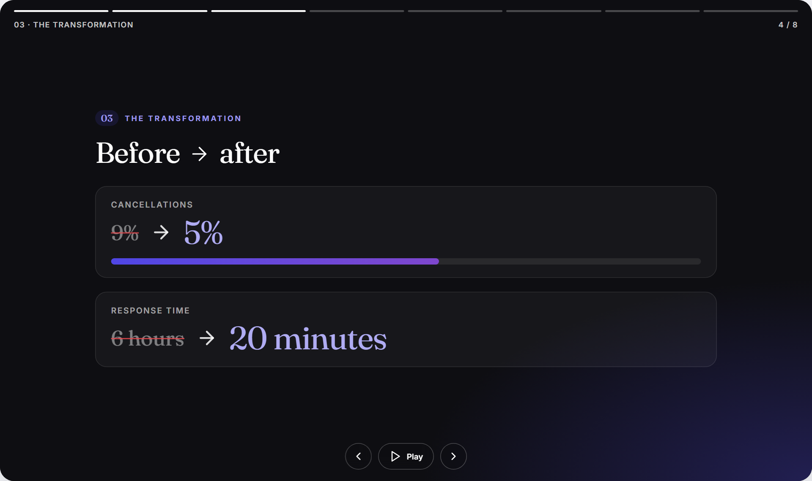
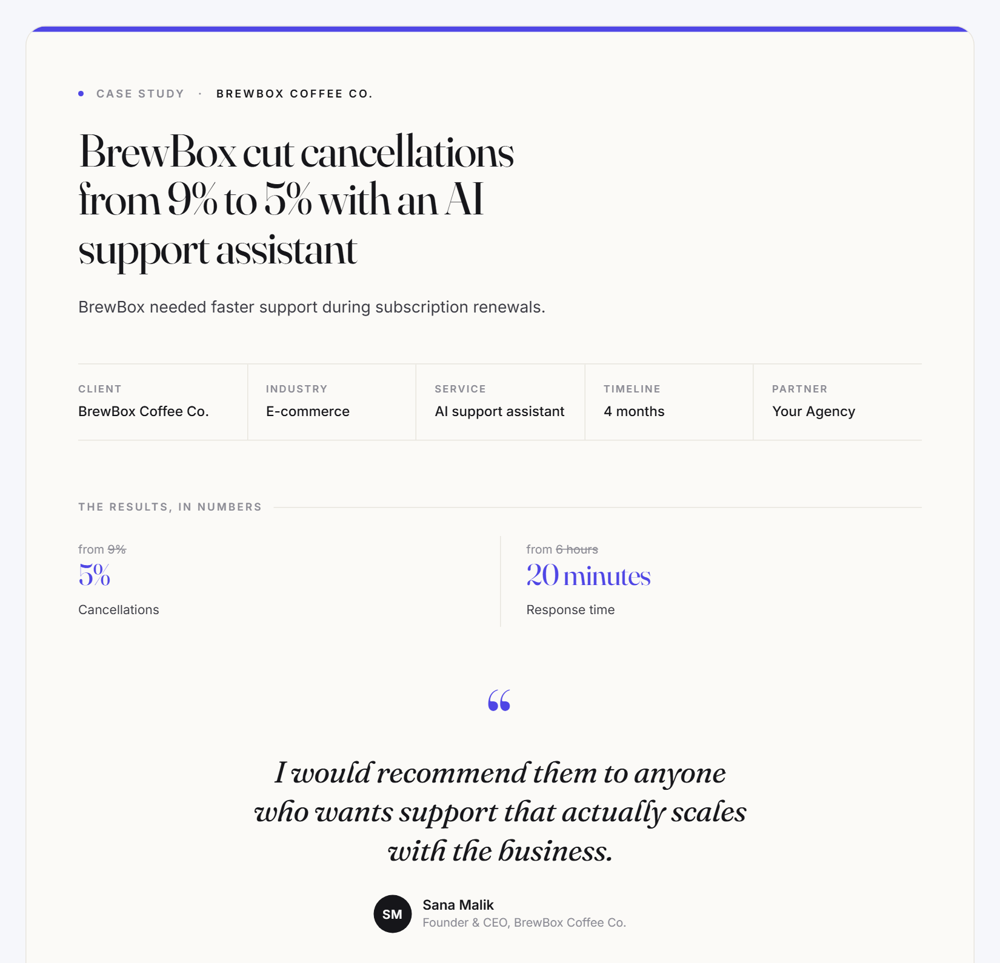

<p align="center">
  
</p>

<h1 align="center">Client Testimonial &amp; Case Study Builder</h1>

<p align="center">
  <em>Client feedback in, proof out, with every number fact-checked against the source.</em>
</p>

<p align="center">
  <a href="assets/demo/demo-landscape.mp4"></a>
  <br />
  <sub>
    <a href="assets/demo/demo-landscape.mp4">Watch the 22-second demo (MP4)</a> &middot;
    <a href="assets/demo/demo-vertical.mp4">vertical cut for TikTok / Reels (MP4)</a> &middot;
    shown with demo data, not real clients
  </sub>
</p>

A Streamlit app that turns raw client feedback (typed notes, emails, interview transcripts, an **interview audio or video recording**, or a **video link**) into polished, ready-to-use marketing content. It uses the **Groq API** for writing and **ElevenLabs** for audio transcription.

**Input:** free-form client notes, a `.txt`/`.md` file, **an audio/video recording, or a link** (YouTube, TikTok, Google Drive, Dropbox), plus basic project details
**Output:**

- **3–5 testimonial quotes** in short, medium and long lengths, each credited to the person who said it, with one-click copy
- **A case study outline**: Challenge → Solution → Results, with a key metrics table
- **A visual case study**: an animated story player and an editorial full-page view, in your chosen brand colour
- **A clean Markdown file**, ready to download

---

## Key features

- **Audio, video and links.** Drag and drop an audio or video recording, or paste a link. Videos are converted to audio on your computer first. The recording is transcribed with speaker labels, you name each speaker, and it becomes a transcript in the same format as the samples.
- **Works with messy input.** Handles multi-speaker interview transcripts with timestamps, casual emails and rough bullet notes.
- **Doesn't invent facts.** The AI is told to use only what's in the notes, and every result is then **checked in code** against the original text.
- **Corrects itself.** If the fact check finds a problem, it's sent back to the AI once for correction. Anything still wrong is clearly flagged for review.
- **Credits the right speaker.** Quotes are attributed to whoever actually said them, and an approval reminder is added when that isn't the main contact.
- **Ready to use.** Testimonials open with a featured quote, can be filtered by length, and copy with their attribution. The case study comes as an auto-playing story or a full page, and the whole result exports as Markdown.
- **Short video.** One click makes a vertical video for TikTok, Reels or Shorts, as branded slides or as a free AI-generated film of the client's story, with an optional free voiceover.
- **Ready to share.** Captions and hashtags tailored to LinkedIn, TikTok, Instagram, Facebook and YouTube, with a button for each that copies the caption and opens the upload page.
- **Ready to demo.** Four realistic sample inputs are included.

---

## See it in action

All screenshots use the built-in demo data, not real clients.

<table>
  <tr>
    <td width="50%"><a href="assets/screenshots/01-add-feedback.png"></a></td>
    <td width="50%"><a href="assets/screenshots/02-testimonials.png"></a></td>
  </tr>
  <tr>
    <td align="center"><b>1. Add feedback</b><br />Notes, a file, a recording or a link, plus the project details</td>
    <td align="center"><b>2. Testimonials</b><br />Fact-checked, with a featured quote, length filters and one-click copy</td>
  </tr>
  <tr>
    <td width="50%"><a href="assets/screenshots/03-story-player.png"></a></td>
    <td width="50%"><a href="assets/screenshots/04-case-study.png"></a></td>
  </tr>
  <tr>
    <td align="center"><b>3. Story player</b><br />An auto-playing, chapter-by-chapter case study</td>
    <td align="center"><b>4. Full-page case study</b><br />The same story as an editorial page, in your brand colour</td>
  </tr>
</table>

---

## Quick start

### 1. Requirements

- **Python 3.10 or newer**: check with `python --version`
- **A free Groq API key** from https://console.groq.com/keys (required)
- **A free ElevenLabs API key** from https://elevenlabs.io/app/settings/api-keys (optional, only needed for audio, video or links)

### 2. Install

Clone the repository and open a terminal in the project folder:

```bash
git clone https://github.com/Abdul-Qahir-Jalali/Client-Testimonial-Case-Study-Builder.git
cd Client-Testimonial-Case-Study-Builder
```

Then create a virtual environment and install the dependencies:

**Windows (Command Prompt)**
```bat
python -m venv .venv
.venv\Scripts\activate
python -m pip install -r requirements.txt
```

**Windows (PowerShell)**
```powershell
python -m venv .venv
Set-ExecutionPolicy -Scope Process -ExecutionPolicy Bypass
.venv\Scripts\activate
python -m pip install -r requirements.txt
```

**macOS / Linux**
```bash
python3 -m venv .venv
source .venv/bin/activate
python -m pip install -r requirements.txt
```

When the virtual environment is active, `(.venv)` appears at the start of the terminal line.

### 3. Add your API keys

Create a `.env` file from the template:

| Windows | macOS / Linux |
|---|---|
| `copy .env.example .env` | `cp .env.example .env` |

Open `.env` in any text editor and replace the placeholders with your keys:

```env
GROQ_API_KEY=your_groq_api_key_here
GROQ_MODEL=openai/gpt-oss-120b

ELEVENLABS_API_KEY=your_elevenlabs_api_key_here
ELEVENLABS_STT_MODEL=scribe_v2

AGENCY_NAME=Your Agency Name

# Optional, for the Video tab (see "Short vertical video")
HF_TOKEN=
```

Don't put quotes or spaces around the keys. Your `.env` is listed in `.gitignore`, so it is never committed. Without an ElevenLabs key, everything works except audio, video and link transcription. Video conversion uses the `imageio-ffmpeg` package (installed by `requirements.txt`), so no separate ffmpeg install is needed.

### 4. Run

```bash
streamlit run app.py
```

The app opens in your browser at **http://localhost:8501**. To stop it, press `Ctrl + C` in the terminal.

**To run it again later,** open a terminal in the project folder, activate the environment (step 2), then run `streamlit run app.py`.

---

## Using the app

1. **Add the client feedback** in one of three ways (or load a sample from the left sidebar):
   - **Type / paste text** straight into the notes box
   - **Upload text file**: drag and drop a `.txt` or `.md` file
   - **Audio / video**: upload a recording or paste a link (see *Using a recording or link* below)
2. **Check the project details** on the right: client, contact, role, industry, service, timeline.
3. Optionally set your **agency name** and the **case study colour** in the left sidebar, then click **Generate content**. It usually takes 10–30 seconds.
4. Review the results:
   - **Testimonials**: the strongest quote is featured at the top; each card shows its length, theme and speaker. Filter by **Short / Medium / Long**, and use **Copy** (one quote, with its attribution) or **Copy all** to paste straight into a page or proposal
   - **Case study**: two views:
     - **Story** (default): an animated, auto-playing visual story, chapter by chapter: cover, the challenge (problem numbers in red), the approach (a step flow that draws itself), the transformation (numbers counting from *before* to *after* with animated bars), the results (count-up metrics), client quotes revealed word by word, and a closing. Use the previous / next buttons, the arrow keys, the progress bar or space to pause.
     - **Full page**: the same case study as an editorial page to read in full.

     The **Case study colour** from the sidebar is used in both views. The internal *Review before publishing* checklist sits in a separate collapsible box above, so it never appears in the client view.
   - **Markdown**: the final file
   - **Video**: a 1080x1920 vertical MP4 for TikTok, Reels and Shorts (see *Short vertical video* below)
5. Click **Download Markdown** or **Save to output/ folder**.

### Short vertical video

The **Video** tab turns the fact-checked result into a 20–35 second 9:16 video: hook with the headline number, the challenge, the results, the best client quote and a closing card with your agency name. Pick a style, optionally keep the voiceover on, and click **Create video**.

| Style | What it is | Needs |
|---|---|---|
| **Animated slides** | Animated with [HyperFrames](https://hyperframes.heygen.com): text that reveals word by word, numbers that count up, bars that fill, a drawn logo, a moving gradient background and smooth transitions, in your case study colour. Everything on screen is your fact-checked content | [Node.js 22+](https://nodejs.org) and FFmpeg with ffprobe (`winget install Gyan.FFmpeg`); the first run downloads HyperFrames; about 3–6 minutes. Without them you get simpler slides with fades and a slow zoom, made offline in under a minute |
| **AI-generated film** | A real prompt-to-video film of the client's story: Groq writes a 3-shot storyboard, each shot is generated from its prompt and animated by free open-source AI (FLUX for the frame, Wan 2.2 on Hugging Face for the motion), then captions, narration and a results card are added | Internet; expect 3–6 minutes |

- The AI only makes the cinematic footage. Your real numbers always appear on a results card drawn by the app from your checked content, and the narration is told not to invent statistics.
- The voiceover uses free text-to-speech (`edge-tts`) and needs an internet connection. If it fails, you get a silent video.
- The AI models run on free shared services, so quality and speed vary. If they are busy or the daily quota is used up, the app says so and builds the animated-slides version instead.
- A free Hugging Face token is optional: set `HF_TOKEN` in `.env` for a bigger daily limit. `VIDEO_VOICE` and `VIDEO_VOICE_RATE` change the voice and speed.
- Videos are saved in `output/` and can be downloaded from the tab.

### Sharing on social media

The **Share** tab writes a ready-to-post caption and hashtags for **LinkedIn, TikTok, Instagram, Facebook and YouTube Shorts**. Pick a tone, optionally add a link and choose whether to use emojis, then click **Write captions**.

- Each platform gets its own caption, length and hashtag count. YouTube also gets a title. Everything is editable, with a live character counter.
- Every number in the captions is checked against your case study. Anything that cannot be matched is flagged before you post, and quotes are only used word for word.
- Click a platform's button (for example **Open LinkedIn**) to copy the caption and open that platform's upload page. LinkedIn also opens with the text already filled in. Attach the downloaded video there and press Post.
- Nothing is posted automatically. TikTok, Instagram, Facebook and YouTube only allow automatic posting through an approved developer app, so the final upload stays one click on the platform itself. Get the client's approval first.
- Without a Groq key, template captions built from the case study are used instead.

### Using a recording or link

1. Choose **Audio / video**, then pick one of:
   - **Upload a file**: drag and drop an **audio** file (mp3, wav, m4a, ogg, flac, aac, opus, wma) or a **video** file (mp4, mov, mkv, avi, webm, wmv, flv, m4v, 3gp, mpeg). For video, only the audio track is extracted and sent, so even large videos upload quickly.
   - **Paste a link**: a public **YouTube**, **TikTok**, **Google Drive** or **Dropbox** link, or a direct link to an audio/video file. ElevenLabs downloads the media itself, so nothing is downloaded to your computer.
2. Optionally set the **Number of speakers** (more accurate if you know it), then click **Transcribe**.
3. Under **Who is who?**, each detected speaker is shown with a sample line. Type each person's **name** and set their **role**:
   - **Interviewer** (your team): their questions are never treated as client claims
   - **Client**: their words are used for the testimonials, credited to the name you enter
4. Click **Use this transcript**. The transcript appears in the notes box, where you can review or edit it, then click **Generate**.

**Good to know:**
- Links must be **public**. Private, unlisted-with-login or members-only videos can't be fetched; download the file and upload it instead.
- Only transcribe recordings you have permission to use, and get the client's consent before uploading real interviews (recordings are sent to ElevenLabs).
- ElevenLabs' free plan includes a few hours of transcription per month. Check https://elevenlabs.io/pricing for current limits and commercial-use terms.

**Fact-check messages you may see:**

| Message | Meaning |
|---|---|
| *Fact check passed* | Every number matches the notes |
| *Fact check caught N issue(s) in the first draft* | The AI made mistakes and corrected them itself (click to see what) |
| *Fact check - please review* | Something still needs a human look before publishing |

---

## Sample inputs

The `samples/` folder has four demo inputs, available from the sidebar:

| Sample | Input style | What it tests |
|---|---|---|
| BrightPath Dental | Q&A interview | Basic interview format |
| Northwind Logistics | Casual client email | Informal writing, a privacy request |
| Urban Threads | Rough bullet call notes | Fragmented notes, third-person remarks |
| Sunrise Fitness | Multi-speaker transcript with timestamps | Interviewer guesses the client corrects, a figure the client won't share, two client-side speakers, small talk |

---

## How it works

```
Typed notes / text file / audio recording
          │   (audio → ElevenLabs Scribe → speaker-labelled transcript → you name the speakers)
          ▼
Notes + project details
          │
          ▼
1. Prompt      Strict rules: use only facts from the notes, never calculate new numbers,
               keep each number's timeframe, credit the right speaker, return JSON
          │
          ▼
2. Groq LLM    Returns structured JSON (testimonials, case study, review notes)
          │
          ▼
3. Validate    Checks the structure (3–5 quotes, all sections present); retries if invalid
          │
          ▼
4. Fact check  Compares the output with the original notes in code:
               • numbers that don't appear in the notes
               • "by 25%" used when the notes say "from 40% to 15%"
               • a figure moved to a different timeframe
               • a quote credited to the wrong speaker
               • the same statistic repeated across quotes
          │
          ▼
5. Self-fix    If problems are found, they're sent back to the model once for correction;
               anything still wrong is flagged in red and in the review checklist
          │
          ▼
6. Render      Jinja2 template → clean Markdown file
```

---

## Project structure

```
Client-Testimonial-Case-Study-Builder/
├── app.py                      # Streamlit web interface
├── ui.py                       # Visual design: styles, header, cards, result components
├── icons.py                    # Lucide icons (vendored SVGs) used across the UI
├── favicon.svg                 # Browser-tab icon
├── assets/                     # Logo files (mark and full lockup)
│   ├── demo/                   # 22-second launch video (landscape and vertical), posters and preview GIFs
│   └── screenshots/            # README screenshots (demo data)
├── generator.py                # Main pipeline: Groq call, validation, self-correction, rendering
├── prompts.py                  # AI instructions and JSON output format
├── factcheck.py                # Code-level fact checks against the original notes
├── testimonial_view.py         # Testimonials tab: featured quote, filters, copy buttons
├── story_view.py               # Animated case-study story player (Story view)
├── case_study_view.py          # Editorial case-study page (Full page view)
├── video_maker.py              # Video tab: scenes, captions, voiceover and ffmpeg assembly
├── social.py                   # Share tab: per-platform captions, hashtags and number check
├── share_view.py               # Share tab: copy-and-open buttons
├── motion_video.py             # Animated slides: HyperFrames composition (GSAP) and render
├── ai_video.py                 # Free prompt-to-video: storyboard, FLUX frames, Wan 2.2 animation
├── transcribe.py               # Audio / video / link → speaker-labelled transcript (ElevenLabs Scribe)
├── cli.py                      # Optional command-line version
├── templates/
│   └── case_study.md.j2        # Markdown output template
├── samples/                    # Demo inputs
├── output/                     # Saved Markdown files (not committed)
├── .streamlit/config.toml      # Allows uploads up to 2 GB
├── .env.example                # Settings template (copy to .env, never commit .env)
├── .gitignore                  # Keeps .env, the virtual environment and generated output out of Git
└── requirements.txt            # Python dependencies
```

Groq's API is OpenAI-compatible, so the project uses the `openai` Python package as its client library. All requests go to Groq.

---

## Optional: command line

The same pipeline can run without the browser:

```bash
python cli.py --all-samples                                      # process every sample
python cli.py samples/northwind_logistics_email.txt --print      # one file, print the result
python cli.py my_notes.txt --client "Acme Ltd" --contact "Jane Doe" --role "CEO"

# audio or video file: names in speaking order, mark your own team with (Interviewer)
python cli.py interview.mp3 --speaker-names "Bilal (Interviewer), Hamza Qureshi" --client "Sunrise Fitness" --contact "Hamza Qureshi"
python cli.py interview.mp4 --speaker-names "Bilal (Interviewer), Hamza Qureshi"

# link
python cli.py "https://www.youtube.com/watch?v=..." --speaker-names "Bilal (Interviewer), Hamza Qureshi"
```

For audio, video and links, the transcript is also saved to `output/` as `<name>-transcript.txt`.

Results are saved to `output/<client>-case-study-<timestamp>.md`.

---

## Troubleshooting

| Problem | Solution |
|---|---|
| Red message: *Groq API key not found* | Check that the file is named exactly `.env` (not `.env.txt` or `.env.example`) and the key is filled in. Restart the app. |
| *Groq rejected the API key* | The key is wrong or was deleted. Create a new one at https://console.groq.com/keys |
| *Model ... was not found* | Set a current model in `.env`, e.g. `GROQ_MODEL=openai/gpt-oss-20b`. See https://console.groq.com/docs/models |
| *Rate limit reached* | Groq free-tier limit. Wait a minute and try again. |
| *Audio transcription needs an ElevenLabs API key* | Add `ELEVENLABS_API_KEY` to `.env` and restart the app. |
| *ElevenLabs rejected the API key* | Check the key at https://elevenlabs.io/app/settings/api-keys |
| *ElevenLabs free credits ... used up* | The monthly free allowance is used. Wait for the reset or upgrade the plan. |
| *Could not fetch media from this link* | The video must be public. Try opening the link in a private browser window; if it asks you to log in, download the file and upload it instead. |
| *This video has no audio track* | The file has no sound. Check you uploaded the right recording. |
| *Video conversion is unavailable* | Run `python -m pip install -r requirements.txt` again (installs `imageio-ffmpeg`). |
| Speakers mixed up in a transcript | Set **Number of speakers** before transcribing, and fix any names directly in the notes box. |
| *Running scripts is disabled* (PowerShell) | Run `Set-ExecutionPolicy -Scope Process -ExecutionPolicy Bypass` first, or use Command Prompt. |
| `streamlit` / `pip` is not recognized | Activate the virtual environment first (step 2). |
| `python` is not recognized | Install Python from python.org and tick **"Add Python to PATH"**. |

---

## Credits

- Demo video music: "Happy Beats: Business Moves" by Sascha Ende ([ende.app](https://ende.app)), licensed [CC BY 4.0](https://creativecommons.org/licenses/by/4.0/).
- Demo video sound effects: [Kenney](https://kenney.nl) and unicae_games, public domain (CC0).
- Icons: [Lucide](https://lucide.dev), ISC licence.

---

> **Note:** Generated content is a draft. Always review it and get the client's approval before publishing any testimonial.
